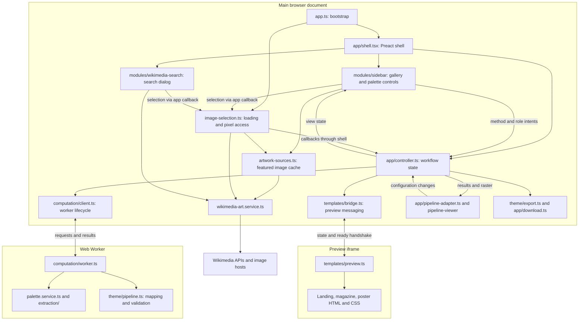

# Architecture

Palette Masters is a browser application with three execution contexts: a Preact
application shell, a Web Worker for palette computation, and a same-origin iframe
for template previews. Vite builds `index.html`, `preview.html`, and the worker.
There is no application backend; artwork metadata and images come from Wikimedia
or bundled image sources.

## Module map

The diagram shows runtime communication. The shell mounts the UI modules and
adapters; the controller coordinates their work through typed ports.

## Ownership and contracts

| Module / entry | Responsibility and public contract |
| --- | --- |
| `src/app.ts` | Creates the Wikimedia service, shared artwork sources, shell, and image-selection workflow; selects the initial painting. |
| `src/app/index.ts` | Exports `createAppShell(root, art, sources, actions)`. The returned `AppShell` exposes `selectionStarted`, `showImage`, `pixelsReady`, and `dispose`. |
| `src/app/controller.ts` | Owns selected artwork and raster, extraction configuration, palette, role assignments, theme tokens, current template, pending state, and errors. Uses `ControllerPorts` for computation and UI output. |
| `src/modules/sidebar/index.ts` | `mountSidebar(root, options)` returns `update(SidebarState)` and `dispose`. Owns gallery navigation and expansion animation; callbacks report selection, method, role, shuffle, and viewer intents. |
| `src/modules/wikimedia-search/index.ts` | `mountWikimediaSearch(dialog, { service, onSelect })` returns `open`, `close`, and `dispose`. Owns debounced Wikidata suggestions, paginated Commons results, image preloading, and cancellation. |
| `src/image-selection.ts` | Owns image loading, pixel access, stale-selection guards, and displayed blob URL lifetime. Reports progress through `SelectionView`. |
| `src/computation/client.ts` | `createComputation()` returns `run`, `cancel`, and `dispose`. Owns worker creation, request IDs, transfer of raster copies, and worker termination. |
| `src/app/pipeline-adapter.ts` | Connects advanced extraction controls to the controller and wraps the imperative `PipelineViewer`; manages viewer focus and cleanup. |
| `src/templates/bridge.ts` | `createTemplatePreview(frame)` returns `update(Partial<PreviewState>)` and `dispose`; retains state until the iframe is ready. |
| `src/templates/preview.ts` | Validates incoming preview state, applies tokens, switches templates, and updates artwork inside the iframe. |
| `src/app/download.ts` | Saves the Tailwind stylesheet generated by `src/theme/export.ts` and releases download object URLs. |

The shell and search use per-mount Signals; sidebar interaction state uses Preact
hooks. The shell owns the sidebar/dialog host elements, while each module renders
its own Preact root. A layout effect connects the controller before shell creation
returns, so image-selection callbacks can run immediately.

The controller's sidebar contract exposes read-only colors and swatch IDs. It
currently passes the palette object structurally through that narrowed type;
this is a TypeScript boundary, not a copied or frozen runtime object. Sidebar
code does not consume extraction provenance. UI modules communicate through
callbacks and public entry points rather than sibling DOM or a global store.

## Selection and computation

1. A gallery or search selection reaches the image-selection workflow through the
   app callback. Search preloads its selected image before emitting the intent.
2. Image selection cancels the previous selection, shows an available image URL,
   and reads pixels through the Wikimedia service. Shared featured lookups are
   cached by `artwork-sources.ts`.
3. The controller receives pixels through the shell and submits an extraction
   request. The worker fingerprints the raster, runs extraction and preset
   comparisons, captures visual history, and maps the palette to theme tokens.
4. The controller accepts only current results and updates sidebar state, export
   availability, and preview tokens. Palette provenance and the original raster
   remain available for the pipeline viewer.
5. Role edits and shuffles request theme mapping from existing swatches. Template
   changes remap when required; a switch during extraction remaps the completed
   palette before publishing. Method or advanced-configuration changes rerun
   extraction.

The worker starts lazily and is reused while idle. Superseding busy work terminates
it; request IDs and controller revisions reject late results. A transferred copy
keeps the original raster available on the main thread. There is no synchronous
UI fallback for worker failure.

While work is pending, previous colors remain visible but export, role editing,
and viewer opening are disabled. Computation errors preserve those colors and
allow retry through another painting or method. Advanced-control results refresh
an open viewer without reopening one the user closed.

## Preview and styling

The preview uses `./preview.html` and receives state through `postMessage`.
Both sides check message origin and source; the renderer also validates the state
shape. A ready/hello handshake sends the latest state after initial load or reload.
The iframe isolates template styles, fonts, icons, and responsive layout from the
application shell. Its renderer uses direct DOM updates rather than Preact.

Application styles live in `index.html`, `src/theme/shell.css`, and component CSS
files. Preview styles are loaded through `src/templates/`; the Tailwind color
contract is in `src/theme/tailwind.css`. Shared artwork rendering has separate
Preact and DOM helpers for the application and iframe.

## Cleanup

Vite hot replacement disposes image selection and the shell. Shell unmounting
cleans up the controller and its worker, sidebar, search, viewer adapter, preview
bridge, and download adapter. Disposed shell callbacks no longer reach a controller.

Image selection aborts pending work and releases displayed blob URLs. Search
aborts suggestions, result requests, and image preloads on cancellation or close.
Sidebar cleanup removes animation resources and ignores late thumbnail results;
shared featured lookups remain reusable rather than being cancelled by one view.

## Verification

Existing tests cover these boundaries:

- `tests/browser/module-boundaries.spec.mjs`: isolated sidebar mounting, intents,
  updates, and cleanup.
- `tests/browser/shell-lifecycle.spec.mjs`: stable module hosts, independent
  workflow instances, disposal, and retaining the previous theme during loading.
- `tests/browser/computation.spec.mjs`: worker parity, cancellation, stale results,
  template remapping, failure recovery, and UI responsiveness during computation.
- `tests/browser/search.spec.mjs` and `search-autocomplete.spec.mjs`: search and
  suggestion behavior.
- `tests/browser/template-isolation.spec.mjs` and `theme-export.spec.mjs`: iframe
  isolation and exported theme behavior.
- `tests/image-selection.test.mjs` and `download.test.mjs`: image and download
  lifecycle behavior.

Run `npm test` for unit tests and `npm run test:browser` for browser tests
(requires Google Chrome). See [color extraction](COLOR_EXTRACTION.md) for pipeline
details.
